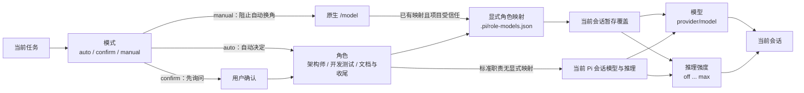

# pi-init

Pi 扩展：为项目生成 AI Coding 协作上下文，并提供角色编排。

## 功能

- 只在缺失时生成项目级 `AGENTS.md`、记忆文档和 `.pi/role-models.json`；生成后归项目维护者所有，重复初始化和插件升级不覆盖。
- 随 package 发布公共 `pi-init-role-routing` Skill，集中维护角色职责、路由、交接与工作流规则；新项目不再生成项目级角色 Skill。
- 按风险分级执行：只读咨询和目标明确的低风险开发直接自主推进，不为一般技术选择、排查顺序或恢复既定行为的 bug 反复询问或交接；用户要求简单任务只做实现时，不默认运行全量测试、类型检查或构建，只保留最小必要核对并说明未执行项；复杂/高风险任务仍保留结构化证据、角色边界、真实验证和授权。
- 通过统一的 `/pi-init` 控制中心完成初始化、角色配置和模型切换。
- 根据任务在公共 Skill 定义的职责之间切换模型；项目通过 `roleModels` 映射配置显式模型并启用自定义角色，内置标准职责无映射时沿用当前会话模型。
- 支持 `auto`、`confirm`、`manual` 三种角色切换模式。
- 活动 Agent 回合内的真实角色或模型切换会保存交接记录并结束旧回合，等 settled 后仅派发一次新职责续跑，重新生成当前职责的系统提示；同职责确认、闲置切角不额外启动回合。交接绑定 session、branch/角色代次及业务身份，过期交接不续跑，保存失败或派发结果未知不自动重放。
- 提供项目级任务工作流策略，默认 `workflowMode: "auto"`：`off` 拒绝新规划，`on` 始终编排，`auto` 对不超过 2 个任务的规划跳过编排，由各任务指定角色切换后直接顺序执行。`architect` 只规划且不能作为执行任务角色；plan/replan 会拒绝该角色，旧活动计划不会自动换角或派发。可通过 `/pi-init config workflow` 选择。兼容旧配置中的 `workflowEnabled`，缺失 `workflowMode` 时 `true/false` 映射为 `on/off`。
- 任务规划排序采用软约束：先遵守用户明确的优先级、截止要求和硬依赖，再安排可能推翻方案的关键未知项的限时最小验证，其次考虑业务关键路径；只有同层且风险、价值相近时才先易后难。不新增 difficulty/risk 字段，也不自动改写 task_workflow 输入顺序。
- pi-init 工作流按单一主会话顺序执行（local），可由用户确认后在安全任务边界转移至新session，任一时刻仅一个会话拥有执行权；缺省配置和旧 `workflowExecutor: "local"` 配置仍可用。已退役的 Runtime 配置与持久状态不会静默回退或自动迁移，细节见“已退役的旧 Runtime 数据”。
- 未进入 `task_workflow` 的普通外部 Agent 执行会在 TUI 中显示开始时间、结束时间和总耗时报告，并与工作流任务完成报告分开。
- 统一 pi-init 活动区将角色、工作流进度、上下文压缩、可观测的模型请求/输出阶段、工具类别、缓存 token usage 和 session 累计工作时间合并到单一宽度感知信息。TUI 只显示一条位于编辑器下方的活动 widget；RPC 使用同源简明 status，JSON/print 不依赖 UI。Pi 原生 footer、working indicator 和 OSC 7501 保持原样；详细工作流原因与恢复步骤仍可从现有详情入口查看。
- 工作流状态工具、活动栏、进度面板和控制中心共用同一阶段/进度投影。当前项位置只从真实 `tasks` 列表中的 `currentTaskId` 计算一基索引；底部活动栏显示阶段、当前项位置和真实耗时，不重复显示“已完成 x/y”，内部完成统计仍供状态查询、控制中心和完成报告使用。Local 工作流只有在当前 Agent run 的 `message_start` 实际消费与当前 handoff 完整身份匹配的任务消息后才记录启动；“任务执行中”不凭 Agent 忙碌或 Provider 响应推断。
- 可观测性只基于公开 Provider 和工具生命周期事件：不推测 MCP/codemode 内部 I/O；未知工具以通用类别显示，不展示工具参数、命令、路径、URL 或结果。`cacheRead`/`cacheWrite` 是 Provider token usage，不代表磁盘或网络 I/O；完整有效 usage 中的正数按对应字段显示，部分/无效字段不补零或伪装为成功。Pi 1.1.0 可能已将 Provider 未报告的计数归一化为零，因此全零显示为“来源未确认”，不代表 Provider 明确报告零，也不推断缓存命中或未命中。缺失、无效 usage、请求失败、中止和缺少结束事件分别保留状态语义。新 Provider 请求期间，若保留先前完整结果会明确标为“上次”；只有同一请求匹配的最终 assistant `message_end` usage 才显示为“本次”，旧成功不会覆盖本次缺失、无效、未确认零值或错误。
- [运行黑匣子](docs/runtime-diagnostics.md)在可信项目默认启用：正常只保存回合摘要，异常自动留证、同类问题合并，使用 `/blackbox` 查看。控制中心“运行诊断”同时查看项目和本机全局 pi-init 故障，并提供限量脱敏导出及二次确认清理；不上传，也不操作工作流/会话文件。缓存请求诊断按请求记录 hook 可见的原始/归一化 usage 状态及脱敏 HMAC 指纹；零值与字段未上报分开，但关联不可靠、hook 不可用或观测失败时结论保持未知。可比较的连续请求会显示字段指纹及system/context前缀是否变化；不重叠的相邻请求仅作粗略比较，不能证明缓存命中。它不是网络请求/服务端缓存事实，不记录请求正文、headers或原始cache key，也不改变请求或缓存行为；缓存收益仍需依据真实provider观测验证。`PI_INIT_HANDOFF_LOG=0` 完全关闭；`=1` 保留原[详细诊断日志](docs/handoff-diagnostics.md)模式。采集不调用模型、不自动重试任务。
- Pi API peer dependencies：`@earendil-works/pi-ai`、`@earendil-works/pi-coding-agent`、`@earendil-works/pi-tui` 均要求 `^1.3.0`；本地以 `1.3.0` 验证，peer 范围声明不修改已安装的全局 Pi 版本。
- pi-init 不主动请求上下文压缩：普通换角、任务/重规划边界、工具组结束和容量检查都不生成压缩摘要，不再维护经济收益预测或额外预算触发器。容量保护与手动压缩交由 Pi 原生机制；TaskMemory、checkpoint、角色确认和未知结果保护继续保留。可独立使用 SoL ObservationPack 打包大结果；不自动启用带独立计划与续跑的 Online Context Compact。
- 角色、任务、重规划和取证交接均从当前状态生成轻量快照：携带身份、状态、下一步和按需读取的契约/验证/审阅引用，不要求模型填写交接表，不复制证据全文。补充说明缺失不阻塞；引用失效或证据不足先读取当前状态并补查/验证，不猜测旧身份。压缩后重新生成快照，保留现有身份、持久化和未知派发保护。
- 记录项目宿主环境和平台相关命令约定。

## 安装与启动

直接在本仓库启动扩展：

```bash
pi --no-extensions -e ./extensions/index.ts
```

然后在 Pi 中执行：

```text
/pi-init
```

可以直接从 GitHub 安装为 Pi package：

```bash
pi install https://github.com/CGOSU/pi-init
```

也可以使用 Git shorthand：

```bash
pi install git:github.com/CGOSU/pi-init
```

仅当前会话临时使用：

```bash
pi -e https://github.com/CGOSU/pi-init
```

本地开发时，也可以从当前目录安装：

```bash
pi install .
```

`init_project` 工具的 `targetDir` 默认为当前工作目录，支持 `dryRun: true` 预览而不写入文件。

### 可选：用量统计

仓库提供跨平台的 `pi-usage` 命令，用于查看 Pi 的模型用量。正常情况下无需单独安装：首次 `pi install` 或执行 `pi update --extensions` 时，package `postinstall` 会自动把启动器和所需支持模块安装到 Pi 可执行目录，之后直接运行：

```bash
pi-usage
```

只有自动安装因找不到 `pi` 或 npm 禁用了 lifecycle scripts 而跳过时，才需要手动补装：

Windows PowerShell：

```powershell
pwsh -File .\scripts\install-launchers.ps1
```

POSIX shell（Linux/macOS/WSL）：

```bash
sh ./scripts/install-launchers.sh
```

- `pi-usage` 默认查询 DuckDB；首次查询、距离上次检查超过 1 小时或跨自然日时，会自动扫描并增量导入 session JSONL。追加写入只读取已保存 checkpoint 之后的新字节；文件截断、改写或尾部校验失败时自动回退为全量重建。使用 `pi-usage --update` 可强制立即检查，日期参数支持 `yesterday`、`7d`/`30d`、`YYYY-MM`、单个 `YYYY-MM-DD`，以及两个日期组成的闭区间（如 `pi-usage 2026-08-01 2026-08-25`）；也可用 `--db <路径>` 指定数据库。默认数据库为 `~/.pi/agent/pi-usage.duckdb`，未安装 DuckDB 时会自动安装到用户目录。Pi fork/branch 复制的历史 entry 按稳定 entry id 跨 session 文件去重；schema v3 首次升级会事务化重建 DuckDB 派生缓存，原始 JSONL 不会修改。报表会显示 DuckDB 缓存的最近更新时间（`YYYY-MM-DD HH:mm`）。
- `pi-usage` 还显示活跃时长、模型等待时长和 session 跨度；Models 表按模型显示 `Avg TPS`（`输出 token 总数 / 有效生成秒数`），采用加权吞吐量而不是简单平均；没有 `pi-token-speed` 采样的历史模型显示 `--`。Overview、Models 和 Time 使用带边框的对齐表格，并额外显示按模型总 token 缩放的柱状图及整体缓存占比（`(Cache R + Cache W) / Total`）。交互终端默认使用 ANSI 颜色，设置 `NO_COLOR=1` 可关闭。活跃时长只连接间隔不超过 5 分钟的事件，避免空闲时间被计入。
- 使用 `pi-usage [时间范围] --output <路径>` 可将查询结果输出为参照每日 AI 对账单样式的纵向 SVG 图片；时间参数与普通查询完全一致，支持 `yesterday`、`7d`/`30d`、`YYYY-MM`、单个 `YYYY-MM-DD`，以及两个日期组成的闭区间。`--output` 目前要求 `.svg` 路径，未指定时仍输出原有文本报表。图片中的费用、模型、Token、缓存命中率和会话数均来自同一份 summary；SVG 不增加图像渲染运行时依赖，也不等同于实际账单。
- `--update` 会强制扫描 session JSONL 并更新 DuckDB 派生表；自动检查只在上述缓存过期时执行，未过期的普通查询直接读取数据库。TTY 下手动更新和首次/过期自动检查都会显示扫描、追加、重建、移除、取 session 文件最新修改时间且精确到分钟的重算日期，以及受影响日期摘要；非 TTY 保持原有报表输出，不额外写入进度信息。session 很多或首次自动安装 DuckDB 时会短暂等待。
- 更新结束后在当前 Pi 会话执行 `/reload`，或重启 Pi，使已加载扩展使用新文件。
- 安装器会把启动器放到 Pi 所在的可执行目录；POSIX 若无写权限则使用 `${XDG_BIN_HOME:-$HOME/.local/bin}`，并提示将其加入 `PATH`。
- 这些辅助命令是可选工具，不会修改系统全局环境变量；换电脑安装或更新 Pi package 时会自动安装，若自动步骤被跳过再按上述方式补装。

## 生成内容

```text
<project-root>/
├── AGENTS.md
├── docs/
│   ├── current-state.md
│   ├── decisions.md
│   ├── session-log.md
│   └── pitfalls.md
└── .pi/
    └── role-models.json
```

初始化提供快速与高级两条路径，只创建缺失文件。AGENTS保留项目定位、目录职责、环境、命令、具体约束和记忆位置，之后由维护者直接编辑；项目模型配置同样不会被重复初始化覆盖，显式配置/保存仍走既有入口。实际创建当前项目文件后才reload，无变更不重复reload。

### 项目文件与插件规范分层

- **项目拥有**：AGENTS、项目记忆、自定义规范、角色模型配置。文件已存在就保留，包含符号链接；使用独占创建防止预览后出现的文件被覆盖。
- **插件拥有**：公共Skill、roles中的职责说明、包内references/clean-code.md。回合开始时以固定section加载通用规则及当前角色，切角替换职责说明，不把旧角色规则继续叠加；不确定或自定义角色不会冒充另一个标准角色。
- 更新插件并reload/重启即更新插件规则，不需要同步项目文档。详细Clean Code细则在编码/结构任务需要时读取，不再生成docs/clean-code.md副本。
- 迁移说明：旧版 `/pi-init sync` 涉及的项目规则现归项目维护者所有；请先人工核对并将需要保留的内容迁入项目文档，再自行清理旧托管内容。插件规则随插件更新，通过 `/reload` 或重启生效；现有项目文件不会被自动同步覆盖。
- 旧AGENTS托管区块、旧docs/clean-code.md和.pi/pi-init-state.json均原样保留；维护者确认后可自行清理重复条款，插件不会猜测并删除手改内容。
- 项目具体要求不被插件通用建议默默替换；身份、工具权限、职责恢复、用户停止和未知副作用等运行时安全门仍然优先。

## 公共角色 Skill 与动态配置

### 公共 Skill 的职责

`skills/pi-init-role-routing/` 随 pi-init package 一起发布，是所有项目共用的职责路由来源：

- `SKILL.md` 维护任务执行流程、证据门控、工具调用、角色边界、交接、真实验证和 `task_workflow` 规则。
- `roles/*.md` 按需提供架构师、开发测试工程师、文档与收尾工程师的职责说明；不需要的角色不会额外加载。
- Skill 只描述职责和流程，不保存具体 provider、model 或 thinkingLevel，也不会自行切换模型；`switch_role` 和扩展运行时负责按项目配置应用模型。
- 它由 Pi 从已安装的 package 加载，不复制到 `~/.pi/agent/skills`；脚手架只生成对它的引用，不生成或覆盖 `.pi/skills/<slug>/SKILL.md`。

因此，公共 Skill 负责“谁在什么边界做什么”，项目 `.pi/role-models.json` 的 `roleModels` 负责保存显式角色模型映射。内置标准角色 `architect`、`developer-test`、`docs-commit` 无需映射即可使用；自定义角色仍需显式映射和对应职责说明。既有项目的旧项目级 Skill 不会自动删除，确认内容后可手动迁移或删除。

`roleModels` 中的每个显式映射值必须包含精确的 `provider`、`model` 和 `thinkingLevel`，并优先于会话默认。保存结构使用 `schemaVersion: 2`；`roleModels` 可省略或为空，例如：

```json
{
  "schemaVersion": 2,
  "roleModels": {
    "architect": { "provider": "provider", "model": "model", "thinkingLevel": "max" },
    "developer-test": { "provider": "provider", "model": "model", "thinkingLevel": "max" },
    "docs-commit": { "provider": "provider", "model": "model", "thinkingLevel": "medium" }
  }
}
```

配置文件缺失或没有任何显式角色映射（包括 `schemaVersion: 2` 缺少 `roleModels`/映射为空且没有兼容的旧版顶层映射）时，标准职责沿用当前 Pi 会话的模型和推理强度；角色切换只改变职责，不另选模型、不生成或持久化 fallback 映射。没有当前会话模型时会报错。损坏 JSON、未知 schema、`roleModels: null`/数组、无效映射字段、显式模型不可用或凭据缺失也会如实失败，不会静默回退。

添加新角色只需两步：

1. 在项目 `.pi/role-models.json` 的 `roleModels` 中加入合法的小写角色 ID及其模型映射；
2. 在公共 Skill package 的 `roles/<role-id>.md` 增加对应职责说明，并更新 package。

运行时不维护独立角色注册表；已配置的新角色可用于菜单和工作流任务，未配置的未知自定义角色不会 fallback 到其他模型。更新 package 后执行 `pi update --extensions`，再在当前会话执行 `/reload`；本地开发可重启 Pi 或重新加载本地扩展。

旧版配置中的顶层 `architect`、`developer-test` 和 `docs-commit` 字段仍会自动读取，但只有用户明确执行 `/pi-init save` 时才规范化写入 `schemaVersion: 2` 与 `roleModels`。旧项目已有的 `.pi/skills/<slug>/SKILL.md` 不会被脚手架自动删除；请人工确认内容后再删除。用户自定义的其他 Skill 同样不会被修改。

## 角色编排

公共 Skill 按交付物选择角色；pi-init 不再为内置标准职责预设固定 provider/model 或推理强度。未显式映射的标准职责沿用当前会话模型和推理强度，显式角色映射仍优先。项目可加入其他合法角色 ID：

- `auto`：自动切换。
- `confirm`：切换前询问。
- `manual`：手动模式。阻止自动换角；原生 `/model` 切换不会被扩展回滚。只有当前活动角色已有显式映射且项目受信任时，切换才更新该映射；标准职责使用会话默认模型时不会创建固定映射。无活动角色或项目不受信任时不写文件。
- `/pi-init role` 和 `switch_role` 只切换当前会话，不写项目配置。
- `/pi-init config [角色]` 与 `/pi-init config workflow` 只暂存当前会话变更；执行 `/pi-init save`（保存角色配置）后才写入 `.pi/role-models.json`。

pi-init 不再调用 `ctx.compact`，也不注册主动压缩策略；换角及任务/重规划交接直接复用当前上下文、TaskMemory与checkpoint。Pi 原生自动容量保护和手动压缩不被拦截或改写，具体是否启用由宿主设置决定。原生或手动压缩完成后仍需重新确认职责，不凭摘要重放工作；暂停和未知结果仍按原恢复路径处理。SoL ObservationPack可独立减少大结果重放，但不等同于全文压缩；本插件不启用或接管SoL Online Context Compact。

旧版本若在任务边界压缩期间被中断，恢复时保留已完成成果并暂停；用户显式执行 `/pi-init workflow resume` 后直接继续尚未派发的任务或重规划，不再重试旧主动压缩。

### 读取与探索策略

普通任务由匹配角色连续调查、实现和验证，切角不重启任务，也不默认创建正式证据链。已确认事实、有效验证与进度按需复用；身份由运行时绑定实际派发回合，模型通常只提交业务结果。轻量调查边界是减少无关探索的软约束，不是搜索审批或路径白名单；来源路径只是优先线索，执行角色可沿直接相关线索扩展，关键事实不足时定向核实。暂停恢复、兼容行为和授权边界见 [`docs/role-continuity.md`](docs/role-continuity.md)；详细职责规则仍由公共 `pi-init-role-routing` Skill 维护。

codemode 在 `tool_call` 阶段有针对异常空输出参数的拒绝保护：仅当 code 参数包含连续至少 256 行单行空 `text()`，且这类行占非空行至少 90% 时拒绝执行。该保护不截断或改写脚本、不自动重放，也无法覆盖未到达 `tool_call` 的生成失败，不能减少已经发生的生成耗时；不应视为通用 JavaScript 检测或安全边界。

`architect` 只分析、决策、规划和安排，仅允许 switch_role 与 task_workflow 的 plan/replan/status/request-replan/request-goal；不得作为执行任务角色，不直接读取仓库、运行代码或连接 MCP。新事实通过普通 docs-commit 调查任务获取，运行时继续守卫执行与验收权限。

### 小改动的轻量路径

默认分组、初始展示、文案或样式等明确局部低风险调整，不因“UI行为变化”自动进入完整调查/文档收尾。先按范围和风险判断，再定向查历史；不整批打印项目记忆。实际选择、连接/路由、业务契约、存储或无障碍行为变化仍升级处理，必要验证和提交安全检查不省。

超过500行只标记结构审阅候选，不强制每次小改动全文件读取或新增keep；结构变化、明确要求或验收需要时再审。候选不会自动标为已审，真正complete仍须当前版本完整读取与fingerprint校验，/large仍可主动审阅。

公共Skill使用SDK提供的真实路径及宿主允许的读取工具，不猜测项目Skill、不绕过context-mode的项目边界。短小的日期/状态/退出码直接回传，No matching不等于空输出或成功；只补取缺失原结果，不能为补输出重放副作用。

轻量执行规则归插件维护，更新并reload即可更新；不再通过sync改写项目AGENTS。已有自定义条款仍由维护者控制，有冲突时明确对齐，不默默覆盖。

### 交付粒度与验证策略

架构师确定目标与边界，按可独立验收的交付物安排任务，而不是把读取、修改、测试分别派发。执行者在范围内自主调查、实现、按风险验证，仅真实目标/边界偏差才重规划。普通低风险任务不强制编排或全仓测试，高风险权限、持久化、恢复及安装更新必须覆盖失败边界。耗时和工具数是诊断信号，不是强制完成/终止条件。

验证可通过 complete 的 evidenceIds 关联当前任务真实成功工具来源；后续直接依赖通过 status 定向读取声明的历史来源。它只证明历史观察存在，不自动证明业务验收或当前版本有效，不恢复正式证据审阅协议。来源与配置未变时复用已有适用结果，不能确认则定向核对，不用每次收尾重跑所有验证。

最终Provider失败不自动nudge重试。同任务续跑提示不是新的任务授权锚点；持续同范围且无新信息的只读重复才触发有界提示/暂停，命令和写入不缓存、不盲目判重。

### 普通调查、任务记忆与上下文

- 调查使用普通 docs-commit 任务，开发使用 files/acceptanceCriteria/实际 verification；缺少关键事实或权限时 block，不建立正式证据或结构契约/clarify 协议。
- task_workflow(checkpoint) 保存当前步骤、成果来源、剩余项与下一步；status 可按 evidenceIds 读取原工具结果，不因上下文裁剪重跑。
- 上下文保留用户指令、真实身份、工作记忆和完整工具组；历史正文可归档，原 session 不改写。真实容量压力交给Pi原生压缩；不能安全恢复时保留停止/恢复边界。
- 正式证据、结构契约/澄清、旧嵌套执行及 /fast 已退役。旧状态返回 WORKFLOW_FEATURE_RETIRED，不自动扁平化、恢复或重放；先核对副作用，再通过受保护的 discard-recovery 隔离或开启新会话。

角色、模型和模式的关系：



用户只需记住一个入口：

```text
/pi-init
```

控制中心提供快速初始化、高级初始化、角色与模型配置、独立的工作流策略配置、角色切换和模式切换；主状态摘要会显示当前工作流策略与执行进度。熟悉命令行时也可以直接使用：

```text

/pi-init init [目录]
/pi-init advanced [目录]
/pi-init role <role-id>
/pi-init config [role-id]
/pi-init config workflow
/pi-init save
/pi-init mode <auto|confirm|manual>
/pi-init workflow stop
/pi-init diagnostics
/blackbox
/blackbox export <project|global> <新文件路径>
/blackbox clear <project|global>
/pi-init coordination resume
/pi-init coordination reopen <reportId> <原因>
```

`/fast` 已退役。普通低风险任务按明确目标连续调查、实现和最小必要验证，不需要额外快捷命令；安全、权限、职责恢复及真实验证仍优先。

`/pi-init coordination resume` 只恢复已确认尚未派发的协作压缩失败；它不会解除证据审阅的 `block`。用户可用 `/pi-init coordination reopen <reportId> <原因>` 显式重开指定问题最新且明确阻塞的报告。重开保留原取证、来源版本和阻塞审阅记录，只创建新的 architect 复审轮次，不自动接受证据或派发开发；Agent 忙碌、项目不可信、状态恢复异常或存在未完成/结果未知的 handoff 时拒绝执行。

### 安全任务边界换新session

- 当前仅支持已持久化的扁平工作流：交付物已完成且剩余任务可启动，没有活动/未知工具、重规划、恢复异常、排队消息或未保存的会话配置覆盖。
- auto模式在任务完成边界、上下文占窗至少70%且精简交接正文较小时提示一次，并暂停下一任务等待选择。70%是保守启发式，不是费用预测；普通聊天、每次换角及网络错误不会触发新session。
- 控制中心 `/pi-init → 工作流 → 操作（a）` 已提供“新建会话继续/fresh”和交接建议时的“留在当前会话继续/resume”；目标待核对导入显示“核对并继续已导入交接”。fresh默认返回，确认后才执行；会话动作后关闭旧面板与控制中心，不复用失效ctx。控制中心还提供“运行诊断”入口，与 `/pi-init diagnostics`、`/blackbox menu` 复用同一诊断面板。
- 用户执行 `/pi-init workflow fresh` 确认新建会话继续，或 `/pi-init workflow resume` 留在原会话。fresh不是task_workflow工具动作；满足安全边界时也可主动使用，不必等70%提示。
- 交接包由已有规划、已验收成果和checkpoint派生，最多32 KiB UTF-8；不额外调用模型写摘要、不复制整段聊天或原始工具日志，超限拒绝而不截断约束。Pi原生压缩兜底及SoL配置不变。
- 旧队列先冻结，新session经setup及fresh context核对后只执行剩余任务；保留逻辑workflowId，显式重绑session，下一任务仍由原调度器生成新attempt。历史验证标注来源；status(evidenceIds)仅可只读复用已声明的已完成直接依赖来源，不能作为本会话新的验证证据。
- 原生创建取消且setup尚未运行时可回到源会话；异常或结果未知保持源冻结，不自动重建。目标部分写入或激活未完成时，在目标再执行fresh只重核导入。旧会话及其较早branch不能继续派发原队列。
- 不承诺比缓存上下文更省token；真实宿主时延、Provider首轮耗时及净费用待实测。

### 停止、保存待办与长任务预算

- `/pi-init workflow stop` 或明确的“停止工作”由运行时停止自动续跑，不靠切角或伪造 complete 退出任务。要求“写进 TODO 之后停止”或仅将当前任务进度输出到 TODO 时，系统从可信工作流派生轻量快照，追加到项目 `TODO.md`，保留已有内容；不要求模型填写交接表，不进入新的任务流，也不跟随 TODO 符号链接。讨论、否定、引用和完成后的条件指令不作为立即停止命令。
- 停止记录绑定当前 session/branch 的工作流，恢复会话时重新读取。活动执行被中断会保存为结果未知；停止不等于取消或副作用确认。明确“继续”或用户执行 resume/retry 只解除停止锁，仍须通过原有恢复/未知结果确认，模型不能用布尔参数代替用户授权。新只读问题可以回答，但不会顺带恢复旧任务；停止后的写入试探会结束当前回合。
- 模型请求最终失败后不自动重试。仅当当前运行实例已确认请求身份、当前任务唯一锚点、所有工具及嵌套调用已收敛且结果已保存，才保留原执行任务并提示直接说“继续”；不按 `fetch failed` 字样或零token猜测安全，不创建新attempt，也不重放已完成工具。额度/认证错误同样须先处理原因。继续前重新校验身份、工具边界、排队消息与持久化；条件失效则保持停止，reload/重启、旧结果未知或业务阻塞仍走原恢复门。
- 同一真实身份下连续 3 个不同调用被同类业务/恢复门拒绝时，运行时停止当前重复回合及自动续跑；穿插普通读取不清空计数。它不限制合法交接次数，不自动重试或切角。
- auto/confirm/manual仅控制职责选择，不控制额外的pi-init压缩策略；本插件不按工具组结束、任务边界或容量预测发起压缩，也不修改Pi原生压缩配置。
- Pi原生或手动压缩后，保留TaskMemory与checkpoint，重新确认当前职责；它不自动恢复暂停任务，不确认未知副作用，也不创建由pi-init压缩回调驱动的额外模型回合。
- `file_review(action="list")` 是全项目受支持代码文件的候选库存分页，不按 path 筛选；传入 path 时返回 `scope: "project"` 和 `ignoredPath`。path 用于 read 和 complete。Markdown 已被代码扩展名集合排除，不例行审阅文档结构。

### 控制中心与次级菜单

`/pi-init` 在 TUI 中打开控制中心，根菜单提升为“初始化”“变更”“同步”“工作流”四个分组；选择“初始化”或“变更”后再进入对应的次级菜单，同步和工作流入口直接执行对应操作。菜单使用尽可能宽的横向区域，选中项的说明会在列表下方独立显示并自动换行，避免窄终端截断。保存不再作为列表项出现，统一使用 `Ctrl+S`（Windows 终端若拦截该组合键，可用 `F2`）；带有次级菜单的入口需要逐级完成选择：

- “变更 · 工作流策略”只配置 `workflowMode`（`off`、`on` 或 `auto`）；工作流执行固定为当前主会话内的 local 顺序执行。命令行入口 `/pi-init config workflow` 也只打开策略菜单。
- 在任一次级菜单选择“返回”或按 `Esc`，都会返回上一级且取消本次尚未完成的配置选择；完成选择后，变更先暂存于当前会话。
- 在任一角色配置菜单中按 `Ctrl+S` 或 `F2`，会保存当前暂存的角色配置；保存完成或失败后仍停留在当前菜单，重复按键不会并发写入。
- `Ctrl+S` 和 `F2` 覆盖控制中心、角色与模型、模式、工作流策略、角色选择、模型搜索和推理强度等层级；初始化表单仍使用 `Enter` 确认、`Esc` 返回。
- 执行 `/pi-init save` 仍是非 TUI 和兼容场景的显式保存入口。

### 调查与职责边界

architect 只分析、规划与安排；允许 plan/replan/status/request-replan/request-goal。需要新事实时安排普通 docs-commit 调查任务，直接交接事实、来源、实际验证和未知。developer-test 实现并验证，docs-commit 维护文档及按授权统一收尾；不额外建立取证审阅状态机。

#### 已退役的旧 Runtime 数据

旧配置中的顶层 `runtime` 字段返回 `RUNTIME_CONFIG_RETIRED`，`workflowExecutor: "runtime"` 返回 `WORKFLOW_EXECUTOR_RETIRED`；请由用户检查并手动清理这些旧配置后再保存，不会自动忽略或改写。含 Runtime executor/authority 的历史 workflow session entry 会以 `WORKFLOW_STATE_RUNTIME_RETIRED` 在状态与动作入口报告恢复失败；pi-init 不会把它本地重放、自动迁移、改写或删除。请保留原始 entry，并由用户自行决定如何处理旧 session。当前未接入任何官方 Runtime 接口。

#### 工作流交接与恢复边界

- 运行时绑定 workflow/session/plan/recovery 与 task/attempt/handoff 身份，拒绝陈旧回调及旧 branch；用户停止、任务消息真实启动和未知副作用确认保护保留。
- 阶段成果使用 checkpoint 保存，任务仍须真实 complete/block；一个任务只有一个执行与验收路径。
- 真实交接先保存结果与身份，再按原守卫派发，不额外生成压缩摘要；失败、迟到或未知派发不得自动继续或重放。
- 旧正式证据、结构契约/clarify、嵌套状态和 Runtime authority 只报告结构化退役诊断，保留原记录。只有受信任、空闲且用户确认副作用后才允许隔离指定来源记录，不把隔离当成功或取消。

### 取消、告警确认与历史恢复处置

- `/pi-init workflow cancel` 与工具同名动作取消当前共享队列；cancel-all 仅作为同一扁平取消的兼容别名。先持久化状态再撤销原身份续跑，写入失败不报告成功。取消不回滚副作用，也不保证已运行工具、进程或宿主压缩停止；旧嵌套状态只能按恢复诊断隔离，不再返回父层。
- `task_workflow` 工具收到 `AbortSignal` 只中止本次工具操作，不会取消或改写整个工作流，也不等同于上面的 `cancel` 命令。
- `/pi-init workflow acknowledge` 仅降低当前 session 中匹配告警的前台突出程度；详细状态、诊断、权限和恢复守卫保持不变。告警原因或 workflow/recovery/attempt 身份改变、切换 branch 或重新加载 session 后，未解决问题会重新突出；工作流进入 `completed`/`cancelled` 或不再有告警时清除对应标记。确认不是取消，也不会确认或隐藏独立的宿主压缩事实。
- `/pi-init workflow status` 会提供恢复分类和受限建议。仅对明确列为不可恢复且没有可读/待持久化工作流状态的历史记录，才可考虑 `/pi-init workflow discard-recovery <entryId> --confirm-unknown-outcome`。它要求项目受信任、Agent 空闲、指定当前 branch 中唯一且最新的原始工作流 entry ID，并先核对任务可能产生的外部副作用、显式确认未知结果。成功会在原记录之后追加版本化处置记录；原记录不删除或改写，也不生成成功/取消状态、不回滚副作用、不自动重跑任务。
- session 身份缺失或不匹配、可恢复状态、权限/存储失败以及未知错误都不能通过 `discard-recovery` 绕过；应按 `status` 给出的对应安全路径处理。隔离不是任务成功的证明。

### 活动工作流中的目标与队列

使用 request-replan 修改当前未完成计划，request-goal 插入目标分组；goals/goalId 只表达归属，所有任务仍共用同一个 workflow ID、依赖队列和 executor。依赖先于 priority，同级稳定，不抢占当前工具。插入目标必须 retainTaskIds 保留仍有效的 pending 任务；分组完成不等于全局验收。旧 parentStack/review-child 不再执行，恢复边界明确退役。

### 模型引用策略

模型安全来自角色和工作流配置中的明确引用，不维护 Provider 白名单（`1.1.0` 起移除 `providerPolicy`，旧配置中的该字段会被忽略）：

- 显式角色模型映射使用完整 `provider/model` 引用，并要求显式引用在注册表中存在；标准职责无显式映射时直接沿用当前会话模型。
- 原生 Agent 子代理由 Pi 宿主决定模型；pi-init 不注入、不校验、不拦截其 `model` 参数，模糊名称和跨 Provider 解析由宿主负责。
历史上的 OpenRouter 意外调用曾与 Agent 子代理的模糊模型解析有关；当前项目不再在原生 Agent 边界重复实现模型路由，需要控制该行为时应配置 Pi 宿主或显式使用完整模型引用。

原生 `/model` 切换由用户自主决定，扩展不回滚、不拦截。需要使用其他 Provider 时：

- `/pi-init config [角色]`：候选列表展示全部已注册模型（含刚登录的 Provider），随时暂存；在 TUI 配置菜单中按 `Ctrl+S`，或执行 `/pi-init save`，即可持久化。
- 直接编辑 `.pi/role-models.json` 的角色模型：保存即生效。
- 手动模式（`mode: "manual"`）：原生 `/model` 切换保留宿主行为；只有活动角色已有显式映射且项目受信任时才更新该映射。使用会话默认模型的标准职责不会因手动切换而生成固定映射。

注意取舍：完全限定的跨 Provider 引用（如 AI 主动写 `openrouter/...`）不会被拦截——如果你需要严格限制可用 Provider，应当自行在配置中只保留对应角色模型。

每个中间任务完成时只输出该任务的精简报告：任务、摘要、实现原因、耗时和验证。`implementationRationale` 必须由执行角色说明采用该实现的原因和关键取舍，不能重复摘要。验证结果只显示明确失败的验证项；成功项不显示，没有失败项时省略验证行，不再输出灰色 bullet 辅助项。完整 verification 仍保存在工作流状态中。

工作流暂停时，自动暂停通知和 `task_workflow block` 工具结果使用分区摘要，突出暂停状态、阻塞任务、真实原因及恢复建议；结果收起时不以成功标记呈现，展开后才显示完整任务和身份技术状态。通知与 TUI 由同一结构化暂停视图分别渲染，不从已格式化文案反推结构。结果未知时必须先核对外部副作用，再显式确认 retry；block 工具以结果展示为反馈，不另发重复 toast。显式 `task_workflow status`/TUI 查询与持久化状态仍保留完整任务、摘要和细节。

仅当最后一个任务完成、工作流进入 `completed` 时，才输出一次工作流完成报告：目标、进度、最终任务的摘要/实现原因/验证，以及整体开始/结束时间和总耗时；不会重新汇总前序任务。最终任务验证同样只显示明确失败的验证项。这样可以保留最终交付的完整上下文，同时避免任务报告和工作流报告重复。规划、架构审阅等待和任务之间的调度等待不计入整体执行耗时；不调用模型生成主观内容。报告中的开始/结束时间使用系统本地时区，格式为 `YYYY-MM-DD HH:mm:ss±HH:MM`。

未走 `task_workflow` 的普通外部执行仍会显示每轮独立的“普通执行时间报告”，字段包括来源、开始时间、结束时间和总耗时。另在 TUI 中，Pi 工作时显示原生 `Working`；空闲后在编辑器上方显示类似 `─ Worked for 1h 17m 49s ─` 的横向分隔线，其数值累计本次 session 的 Agent 实际工作时间，不包含闲置时间。session 恢复时优先从每轮完成后保存的独立累计快照恢复，并兼容只有普通执行记录的旧 session；活动工作流、扩展隐藏续跑和中断不会重复生成普通报告。

`/pi-init mode`、`/pi-init role`、`switch_role` 和 `/pi-init config` 的运行时变更只影响当前会话；TUI 配置菜单可按 `Ctrl+S` 保存暂存角色配置，非 TUI 或兼容场景仍使用 `/pi-init save`。Pi 原生 `/model` 和 `Shift+Tab` 仍可用于临时切换，角色自动切换以当前会话配置为准。

### 工作流运行时导出函数缺失

若遇到历史符号 `shouldOrchestrateWorkflow` 或当前工作流符号 `validateWorkflowExecutionRoles`、`workflowActionIdentity` 不是函数，不要直接断定是模块缓存、旧 package 或某种更新步骤导致。当前源码已将 `src/roles.js` 等实现迁为 `.ts`；静态 Jiti 调度测试和 Pi 1.1.0 隔离 RPC 冷启动均通过，但无法检查先前报错的长驻 Pi 进程，因此其根因仍未确认。新进程通过不代表旧进程已修复，`/reload` 也未被验证为根因修复。准确的现象、证据和未确认项见 [`docs/pitfalls.md`](docs/pitfalls.md)。

## 全局协作规则

如果所有项目都需要遵守同一套主机规则，可使用 Pi 全局上下文文件：

```text
~/.pi/agent/AGENTS.md
```

`settings.json` 主要用于配置，不适合承载自然语言协作规则。

## 检查与 TypeScript 源码

```bash
npm run typecheck
npm test
```

在 Pi 中使用 `/large` 手动重扫当前项目，并报告超过 500 个物理行的结构候选。扫描完整、状态可确认且存在当前内容版本未审候选时，命令仅在 Agent 空闲且没有未结束或恢复异常的工作流、职责恢复持久化失败时，通过 Pi 用户消息入口尝试启动一次命令专属结构审阅。请求已派发不代表模型已完成审阅或已登记结论；无候选（包括同版本已审）、扫描失败/不完整、状态无法确认、Agent 忙或工作流保护触发时，不启动、排队或抢占审阅。手动扫描可在职责恢复 pending 或 architect 角色下运行，但不会确认恢复状态或解除工具守卫。结构结论仅为 `keep`/`recommend-split` 建议，不自动修改或拆分文件。该命令与扩展内结构审阅共用扫描实现，不依赖 JavaScript/TypeScript 项目。`npm run typecheck` 运行 `tsc --noEmit` 检查 TypeScript 源码；`npm test` 运行 Node 测试。扫描在会话启动时建立当前 session/branch 的观察基线，并在文件工具结果与 Agent 回合边界补扫；支持 `.js`、`.mjs`、`.cjs`、`.ts`、`.mts`、`.cts`、`.tsx`、`.jsx`、Rust `.rs`、Go `.go`、Python `.py`/`.pyi` 和 PHP `.php`/`.phtml`。候选按项目、路径、内容指纹与策略版本跟踪并随当前 session branch 恢复；登记结论前须完整读取当前版本，扫描或持久化失败不会伪装成已审。测试价值审阅功能已退役；项目通用 Test Value Gate、增量补测原则与有价值的业务回归仍然保留。`npm run typecheck` 使用 `strict`、`NodeNext` 检查 `extensions/**/*.ts` 与 `src/**/*.ts`，`allowJs` 为 `false`。本轮文档收尾验证使用 Node v26.11.1；Pi peer/lockfile 版本为 1.1.0。Node `>=22.19.0` 的最低声明版本尚未单独实测。

`file_review` 仅承载大文件结构审阅。默认或显式 `reviewKind="structure"` 的结构审阅针对超过 500 个物理行的代码文件，结论为 `keep`/`recommend-split`；该阈值不是文件上限。旧的显式非结构 `reviewKind` 调用会明确失败，不会静默按结构审阅处理；不传 `reviewKind` 的既有结构调用继续有效。结构结论独立记录在 `pi-init-file-review`，必须完整读取当前内容版本并给出理由；内容变化会使旧结论失效。测试价值审阅入口、候选与状态维护已完整退役。

`file_review(action="read", path, offset=1, limit=100)` 在没有原生 read 时返回可验证的 UTF-8 原文页，也可与原生 read 混合累计当前版本覆盖。offset 是从 1 开始的物理行号，limit 为 1–200 行，默认 100；每页原文最多 16 KiB（元数据另计），保留 BOM、换行与末尾无换行行，不输出半行。跟随返回的 nextOffset 直到 eof；可携带 fingerprint 拒绝版本变化。单行超限返回 LINE_TOO_LONG，不登记该行。仅成功返回的完整行计入覆盖；失败、取消、读取期间内容变化或 session/branch 变化不登记覆盖。路径复用项目边界、排除目录、禁止符号链接及快照校验。complete 仍要求当前指纹的全文覆盖和有效结论；list 仍是从 0 开始、默认 10/最多 50 项的项目候选库存，不按 path 筛选。

若真实调用仍只允许 list/complete，说明宿主尚未使用新工具定义：先核实 Pi 实际加载的扩展路径，再 reload 包含新读取入口的版本，确认 read 动作可用后补齐当前文件覆盖并按原工作流恢复。工作区文件已更新或离线测试通过不等于旧 session 已完成审阅；不要直接改写 session、伪造覆盖或放松 complete。

日常提示（系统提示 section、文件工具结果附加通知和 `agent_settled` 通知）只呈现当前 session/branch 观察基线之后实际观察到的结构候选变化，不代表精准的任务 Git diff 归属，也不重复提醒未变化的既有库存。`file_review(action="list", offset=...)` 与 `/large` 提供完整结构候选库存；增量基线、范围与通知水位只存在于当前 session/branch，恢复、切换 branch 或 reload 后重建，过期异步结果不会写入新上下文。候选通知按结构候选有效版本去重；未送达或受安全门阻断的通知不提前记为已消费。扫描或状态失败保持未确认，不推断未确认的删除或清空未知范围。项目通用 Test Value Gate 和增量补测原则不依赖此结构审阅工具，仍按项目规则执行。

项目通用 Test Value Gate 仅规定测试断言的价值取舍，不会自动发现测试文件、推断实现关联或维护审阅候选。测试选择与补测范围仍按项目规则，围绕实际行为变化、风险和有价值的业务回归确定。
