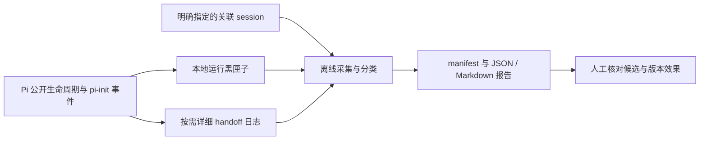

# pi-init 本地诊断采集

此功能面向 pi-init 扩展自身的规划、角色交接、恢复、工具观察和运行成本分析。宿主项目（例如 FlClash）的 Pi session 仅作为关联证据，不为宿主应用添加业务日志。首版输出本地派生报告，不调用模型、不上传，也不修改运行策略。

## 结构与耦合

运行时通过可选 `traceHandoff` 和 Pi 生命周期事件观察状态；日志写入异常被隔离，业务完成、恢复及轮询守卫不依赖日志。现有诊断层仍直接读取角色、工作流、恢复和缓存状态，事件名及数据为内部约定，因此维护耦合并非完全消失。

离线入口 `scripts/diagnostics-report.js` 只依赖文件读取与纯分析模块，不导入扩展入口、SDK、任务调度器或 pi-usage 数据库。其读取、解析、汇总失败不会改变活动工作流。无需给每次任务增加 status、checkpoint 或模型日志整理步骤。



## 使用

现有黑匣子仍在受信任项目默认采集，开关和轮转见[运行诊断](runtime-diagnostics.md)。离线入口不会代替黑匣子开启未来采集，也不设置常驻任务。

在 pi-init 仓库执行，或使用已安装 package 内脚本的实际路径：

```sh
node scripts/diagnostics-report.js \
  --runtime /path/to/project/.pi/diagnostics/runtime.jsonl.1 \
  --runtime /path/to/project/.pi/diagnostics/runtime.jsonl \
  --session /path/to/associated-session.jsonl \
  --output /path/to/new-diagnostic-bundle
```

至少指定一个项目 runtime 文件和一个新输出目录。没有 `.1` 就省略它，不存在的显式输入会报错。可以重复 `--session`；仅汇总有 pi-init 工具/会话标记或由输入 runtime 的 sessionId 确认关联的会话。可选 `--handoff /path/to/project/.pi/logs/handoff.jsonl`，其 `.1` 也需明确指定。详细日志如何开启见[交接日志](handoff-diagnostics.md)。全局诊断是另一种格式，不冒充项目 runtime 输入，未支持的记录会披露。

输出目录必须不存在，其父目录必须存在。文件只在该新目录创建，不覆盖已有报告，不修改输入文件：

- `manifest.json`：来源类型、本地路径、SHA-256、读取字节范围、采集时刻、文件变化及坏行/超限统计，另含采集器源码指纹和两个报告文件的 SHA-256。
- `report.json`：累计故障去重、版本分组、回合结果和健康基线、Provider/cache 观察、关联 session 工具结果及可选详细日志的重复操作候选。
- `report.md`：主要统计与阅读说明，详细口径和来源引用以 JSON 为准。

这是有限来源引用和统计的保存，不是原始日志备份。源文件未来轮转后，无法仅靠报告还原被省略的正文。若需调查具体原因，应在源文件仍可用时根据 `sourceId`、行号和真实 entry/toolCall ID 定向查看。

## 计数与完整性

- 同一 `runtimeId/captureId/sessionId/issue.id` 的初始、封口及复发快照按累计 count 折叠，不把行数当故障数；不同实例和 capture 不混合。
- 版本分组使用加载时 commit、源码指纹与模型配置；相同 package 版本不代表同一实现。没有加载身份的历史数据明确标未知，不用当前磁盘 HEAD 补写过去的身份。
- 全部回合结果与健康耗时样本分别显示。`normal-stop` 只表示模型正常停止，不是业务验收通过；任务复杂度未控制，不能单凭耗时或 token 下降宣称优化成功。
- runtime、session、handoff 可能观察同一操作，分别给出口径，不相加成失败请求总数。session 结果按真实 entry 去重；内层只接受已知结构化回执，不用任意输出文本猜测。正文中吞掉的异常和宿主未暴露的事件仍可能遗漏。
- 相同 session 的重复文件按 entry 去重；不同 session 重用 entry（如 fork 继承历史）列为有来源的重复候选，不自动合并。session 合计是按会话累加的观察，不是全局唯一调用数或账单；活动 branch 也不从这些文件推断。
- 丢弃、未知身份、缺失字段、坏行、无换行尾部、超限和读取过程中变化均披露。显式文件之外的轮转历史是否齐全不能自动证明；按顺序读取文件不构成多文件原子快照。
- 每次最多 32 文件、单文件 64 MiB、总计 128 MiB、100000 条对象记录；单行超过 2 MiB 跳过并计数。文件/总字节超限直接拒绝，解析记录超限保留可见省略计数。

输出目录权限请求为 `0700`，文件为 `0600`（实际支持取决于平台）。不保存用户/模型正文、源码、命令、工具参数/输出和环境变量。manifest 保留本地路径，报告中的模型、工具、标识和错误码仍是元数据，分享前需检查。文件指纹仅用于核对所读字节，不证明输入可信或业务正确。

## 当前改进与后续边界

运行时现已把 `tool.execution_end` 纳入工具失败分类，覆盖只有结束事件的参数校验/嵌套工具失败；同调用的 result/end 去重，并与先发生的显式工作流拒绝关联。工具摘要接受 SDK 的 `structuredContent.exit_code`，保留既有 `details.exitCode` 优先级。不解析错误正文来捏造错误码；缺少结构码仍为 `UNKNOWN`。

[全项目审计](project-audit.md)已修复既有诊断目录/文件链接被跟随的问题，并统一扩展内维护页/导出的有界 no-follow 读取；这些检查不等同于操作系统沙箱，也未验证恶意并发目录替换。详细 handoff 日志仍仅有进程内写队列，跨进程轮转保护、停录后的显式恢复、详细日志指纹的热路径开销仍是后续独立事项。诊断存储/锁失败会停用对应记录器直到 reload，清理日志不会重新启用它；不能由离线报表宣称这些问题已经解决。

下一步可根据报告选择具体候选，提供有来源的修复建议并用固定样本和回归验证。自动采集调度、跨采集目录长期增量库、AI 诊断、隔离修改和自动应用不属于首版；尤其不能让日志中的文字成为执行指令，也不能由诊断自动放松身份、恢复和未知副作用守卫。
