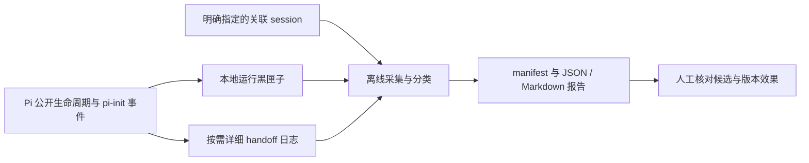

# pi-init 本地诊断采集

此功能面向 pi-init 扩展自身的规划、角色交接、恢复、工具观察和运行成本分析。宿主项目（例如 FlClash）的 Pi session 仅作为关联证据，不为宿主应用添加业务日志。首版输出本地派生报告，不调用模型、不上传，也不修改运行策略。

## 结构与耦合

运行时通过可选 `traceHandoff` 和 Pi 生命周期事件观察状态；日志写入异常被隔离，业务完成、恢复及轮询守卫不依赖日志。现有诊断层仍直接读取角色、工作流、恢复和缓存状态，事件名及数据为内部约定，因此维护耦合并非完全消失。

离线入口 `scripts/diagnostics-report.js` 只依赖文件读取、共享诊断路径规则与纯分析模块，不导入扩展入口、SDK、任务调度器或 pi-usage 数据库。其读取、解析、汇总失败不会改变活动工作流。无需给每次任务增加 status、checkpoint 或模型日志整理步骤。



## 使用

受信任项目默认采集黑匣子。黑匣子与详细交接日志分别存放在 Pi Agent 目录下的 `diagnostics/pi-init/sessions/<projectKey>/` 和 `diagnostics/pi-init/handoff/<projectKey>/`，每个会话各自使用 `<sessionKey>.jsonl` 和最多一个 `.1` 轮转段。单段上限 2 MiB、两个类别合计留存最多 128 组；详见[运行诊断](runtime-diagnostics.md)。离线入口不会开启采集或设置常驻任务。

在 pi-init 仓库执行，或使用已安装 package 内脚本的实际路径：

```sh
node scripts/diagnostics-report.js \
  --project /path/to/project \
  --since 7d \
  --output /path/to/new-diagnostic-bundle
```

- `--project` 用与运行时一致的规范化绝对路径生成键；使用 Pi 实际看到的工作目录拼法（不通过 `realpath` 合并项目别名）。诊断根目录取 `PI_CODING_AGENT_DIR`，默认 `~/.pi/agent`。不扫描工作区、其他项目、全局摘要或 Pi 原始会话目录。
- 可加 `--session-id <原始会话ID>`：按 SDK 会话 ID 生成键，只检查该会话的当前段和 `.1`；不需要原始 session 文件。省略时只枚举所选项目的两个侧车目录。
- `--since` 仅按发现文件的最后修改时间选段，支持正整数 `m/h/d/w`（如 `48h`）。入选段整体分析，可能含更早事件；这不是按事件时间的完整区间统计。省略表示在留存及采样上限内不按时间过滤。
- 除了发现结果，可重复追加 `--runtime`、`--handoff` 或 `--session`。旧项目日志与原始 Pi session 只在明确给出文件路径时读取，不受发现的项目、会话或时间筛选。不会迁移、补写或删除旧文件。

只分析显式冻结样本的示例：

```sh
node scripts/diagnostics-report.js \
  --runtime /path/to/project/.pi/diagnostics/runtime.jsonl.1 \
  --runtime /path/to/project/.pi/diagnostics/runtime.jsonl \
  --session /path/to/associated-session.jsonl \
  --output /path/to/new-diagnostic-bundle
```

不使用 `--project` 时，至少显式指定一个项目 runtime 文件。没有 `.1` 就省略它，不存在或无法读取的显式输入会报错。可显式添加 `--handoff /path/to/project/.pi/logs/handoff.jsonl`；其 `.1` 也要单列。`--session` 仅汇总有 pi-init 工具/会话标记或由输入 runtime 的 sessionId 确认关联的会话。[全局诊断](runtime-diagnostics.md)是另一种格式，不作为项目 runtime；未支持的记录会披露。

输出目录必须不存在，其父目录必须存在。文件只在该新目录创建，不覆盖已有报告，不修改输入文件：

- `manifest.json`：来源类型、本地路径、SHA-256、读取字节范围、采集时刻、文件变化及坏行/超限统计，另含采集器源码指纹和两个报告文件的 SHA-256。
- `report.json`：累计故障去重、版本分组、回合结果和健康基线、Provider/cache 观察、关联 session 工具结果及可选详细日志的重复操作候选。
- `report.md`：主要统计与阅读说明，详细口径和来源引用以 JSON 为准。

这是有限来源引用和统计的保存，不是原始日志备份。源文件未来轮转后，无法仅靠报告还原被省略的正文。若需调查具体原因，应在源文件仍可用时根据 `sourceId`、行号和真实 entry/toolCall ID 定向查看。

## 计数与完整性

- 同一 `runtimeId/captureId/sessionId/issue.id` 的初始、封口及复发快照按累计 count 折叠，不把行数当故障数；不同实例和 capture 不混合。
- 版本分组使用加载时 commit、源码指纹与模型配置；相同 package 版本不代表同一实现。没有加载身份的历史数据明确标未知，不用当前磁盘 HEAD 补写过去的身份。
- 全部回合结果与健康耗时样本分别显示。`normal-stop` 只表示模型正常停止，不是业务验收通过；任务复杂度未控制，不能单凭耗时或 token 下降宣称优化成功。
- runtime、session、handoff 可能观察同一操作，分别给出口径，不相加成失败请求总数。session 结果按真实 entry 去重；内层只接受已知结构化回执，不用任意输出文本猜测。正文中吞掉的异常和宿主未暴露的事件仍可能遗漏。
- 相同 session 的重复文件按 entry 去重；不同 session 重用 entry（如 fork 继承历史）列为有来源的重复候选，不自动合并。session 合计是按会话累加的观察，不是全局唯一调用数或账单；活动 branch 也不从这些文件推断。
- 丢弃、未知身份、缺失字段、坏行、无换行尾部、超限和读取过程中变化均披露。发现时会报告无样本、按时间排除、不能读取、链接、段过大或扫描/文件数量超限；有读取缺口仍会输出已取得的部分。顺序读取不构成多文件原子快照，未报告缺口也不证明历史齐全。
- 每次最多 32 文件、单个显式文件 64 MiB、总计 128 MiB、100000 条对象记录；单行超过 2 MiB 跳过并计数。发现只接受独立普通文件及合格轮转段，每个项目流最多枚举 384 个目录项；该目录超限时不使用任意枚举顺序攒出的部分结果。显式文件优先占用额度，余量给最近修改的发现段；超限不扩大读取，记录省略可核对。

输出目录权限请求为 `0700`，文件为 `0600`（实际支持取决于平台）。不保存用户/模型正文、源码、命令、工具参数/输出和环境变量。manifest 保留本地路径，报告中的模型、工具、标识和错误码仍是元数据，分享前需检查。文件指纹仅用于核对所读字节，不证明输入可信或业务正确。

## 用同任务做版本对照

1. 固定同一任务、输入、验收、模型与推理级别；分别保留修改前后的样本和真实验收结果。可将冻结的旧 `--runtime`/`--handoff` 与新 `--project` 发现结果放进同一报告，按加载 commit、源码指纹和模型配置辨别组别，不拿当前磁盘的 HEAD 给历史数据补身份。
2. 先比较验收是否通过、故障是否复发、恢复与交接是否正确，再比较回合/重复操作候选、健康样本耗时、token 或缓存指标。查看 manifest 和读取缺口，不把 `normal-stop`、fixture 结果、单个样本或单次耗时变化当成实际提效；用量观察不是账单，也不含未被观察到的请求。
3. 人工核对候选并决定是否改动；修改后重新跑同一验收。报告不会改写代码、模型策略或任务状态，不构成自动自我改进。

## 当前改进与后续边界

运行时现已把 `tool.execution_end` 纳入工具失败分类，覆盖只有结束事件的参数校验/嵌套工具失败；同调用的 result/end 去重，并与先发生的显式工作流拒绝关联。工具摘要接受 SDK 的 `structuredContent.exit_code`，保留既有 `details.exitCode` 优先级。不解析错误正文来捏造错误码；缺少结构码仍为 `UNKNOWN`。

[全项目审计](project-audit.md)已修复既有诊断目录/文件链接被跟随的问题，并统一扩展内维护页/导出的有界 no-follow 读取；这些检查不等同于操作系统沙箱，也未验证恶意并发目录替换。停录的项目、全局或 handoff 记录器可通过 `/blackbox resume <project|global|handoff>` 显式恢复。恢复会排空待写、检查目录级跨进程锁和文件可用性并重核项目/session/branch；只接收后续新事件，不补写失败期间记录、不重放任务、不改变采集模式或自动处置遗留锁。两个侧车类别共享一把锁，全局摘要用独立锁；每一类的写入、轮转、恢复和维护在对应锁内执行。离线报告不抢锁，不修改诊断存储。

当前审计实测指纹路径后，未发现足以证明 HMAC 合批值得增加临时缓冲的稳定收益，故保留原有有界逐段 HMAC、可变输入重算和隐私边界。量化数据与可重建测量方法见[全项目审计](project-audit.md#指纹隔离基准不是端到端服务基准)及[会话记录](session-log.md#2026-11-11按当前运行时测量审计后续并统一验证)。自动采集调度、跨采集目录长期增量库、AI 诊断、隔离修改和自动应用不属于首版；尤其不能让日志中的文字成为执行指令，也不能由诊断自动放松身份、恢复和未知副作用守卫。
